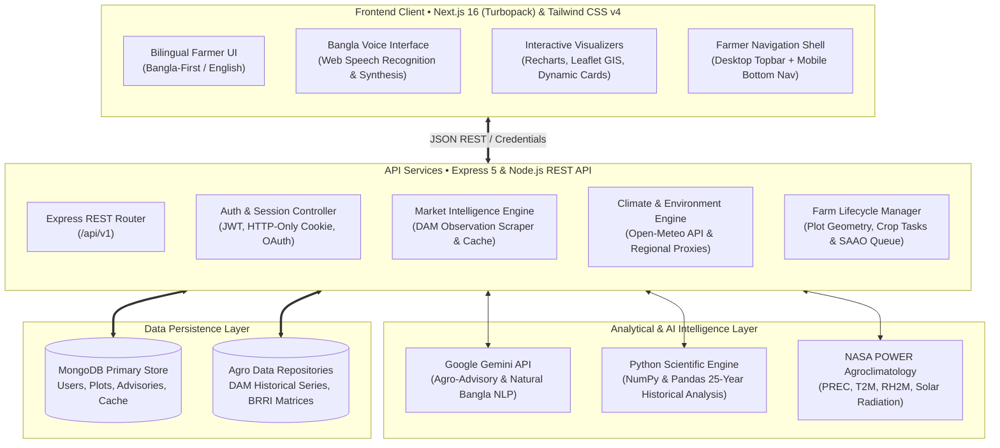

<div align="center">

# KRISHIBONDHU &middot; কৃষিবন্ধু

### An AI-Powered Climate-Smart Farming & Market Intelligence Platform for Bangladesh

**&ldquo;কৃষকের পাশে, প্রতিটি সিদ্ধান্তে&rdquo;**  
*From Seed to Market &mdash; Your Smart Agricultural Companion*

[Executive Summary](#executive-summary) &bull; [Problem & Solution](#problem-statement--proposed-solution) &bull; [System Architecture](#system-architecture) &bull; [Core Modules](#core-features--capabilities) &bull; [NASA Data Integration](#nasa-climate-data-integration) &bull; [End-to-End Workflow](#system-workflow) &bull; [Demonstration Scenario](#demonstration-scenario) &bull; [Impact & Innovation](#innovation-and-impact) &bull; [Developer Quickstart](#local-development--quickstart)

---

</div>

## Executive Summary

**KrishiBondhu** (কৃষিবন্ধু &mdash; *"The Farmer's Trusted Companion"*) is an independent, Bangla-first agricultural decision-support and market intelligence platform designed specifically for smallholder farmers, extension officers, and agricultural researchers across Bangladesh.

Smallholder agriculture in Bangladesh operates at the vulnerable intersection of climate volatility, fragmented advisory services, and asymmetric market bargaining power. KrishiBondhu unifies **25 years of NASA Earth observation data**, hyper-local agro-meteorological forecasts, agronomic crop rotation science, and real-time market economics into a single, accessible digital companion.

Through natural Bangla voice interaction, climate-informed sowing simulation, personalized field-lifecycle tracking, and human-in-the-loop expert verification by Sub-Assistant Agriculture Officers (SAAOs), KrishiBondhu empowers farmers across all four critical decision stages:

```
  ┌──────────────────┐      ┌──────────────────┐      ┌──────────────────┐      ┌──────────────────┐
  │ WHAT TO GROW?    │ ───> │ WHEN TO SOW?     │ ───> │ HOW TO MANAGE?   │ ───> │ WHERE & WHEN     │
  │ Soil, climate &  │      │ Handoff window   │      │ My Farm crop     │      │ TO SELL?         │
  │ rotation models  │      │ 0/7/14-day delay │      │ lifecycle tasks  │      │ Market & costs   │
  └──────────────────┘      └──────────────────┘      └──────────────────┘      └──────────────────┘
```

> [!IMPORTANT]
> **Scientific Integrity & Product Identity**  
> KrishiBondhu is an independent, community-focused initiative. While the platform harnesses satellite data from NASA Earthdata programs (POWER Daily Agroclimatology) and meteorological forecasts from Open-Meteo, this data provenance provides historical context and does not imply official NASA sponsorship or endorsement. All market, weather, and AI recommendations strictly differentiate between validated ground observations, historical probabilities, and demonstration models.

---

## Problem Statement & Proposed Solution

### The Agricultural Dilemma in Bangladesh

Smallholder farmers encounter severe operational and financial bottlenecks across the crop season:

| Challenge | Real-World Vulnerability | KrishiBondhu Solution |
| :--- | :--- | :--- |
| **Crop Selection Uncertainty** | Monoculture rice cycles deplete soil nutrients and extract excessive groundwater. | **AI Crop Recommendation Engine** matching local soil suitability, water requirements, and multi-season rotation science. |
| **Sowing Time Disruption** | Delays between Monsoon T. Aman harvest and Winter Rabi sowing directly degrade yields. | **Handoff Window Analysis** simulating historical climate risks across 0-day, 7-day, and 14-day sowing delay scenarios. |
| **Information Accessibility** | Rural farmers with limited smartphone or literacy access are excluded from digital portals. | **Bangla-First Voice Assistant** with speech synthesis, audio recognition, SMS alerts, and offline fallback guidance. |
| **Unfair Market Realization** | Farmers sell harvest to middlemen at depressed prices without knowing actual production costs. | **Agricultural Market Intelligence** with DAM daily prices, Fair Price Break-Even Calculator, and selling insights. |
| **Fragmented Advisories** | Weather, market prices, fertilizer guidelines, and crop care exist across siloed tools. | **Unified Digital Platform** tracking the complete seed-to-market lifecycle in one synchronized dashboard. |
| **Unverified AI Risks** | Autonomous black-box AI outputs can produce hallucinated or risky farming advice. | **SAAO Human-in-the-Loop Workflow** allowing agricultural officers to verify and calibrate AI advisories before delivery. |

---

## System Architecture

KrishiBondhu is engineered as a resilient, high-throughput monorepo architecture:



---

## Core Features & Capabilities

### 1. AI-Powered Crop Recommendation Engine
- **Suitability & Rotation Modeling:** Evaluates field district, agro-ecological zone (AEZ), soil type, and irrigation availability to suggest optimal 3-season crop sequences (Kharif-1, Kharif-2, Rabi).
- **Cost & Input Comparison:** Quantifies expected fertilizer, seed, and irrigation budgets against projected crop outputs.
- **Explainable Agronomics:** Clearly articulates *why* a particular crop rotation is recommended, its environmental advantages, and potential risk factors.

### 2. Handoff Window &mdash; Smart Sowing Time Analysis
- **Post-Monsoon Transition:** Specifically focuses on the tight transition between Monsoon **T. Aman Rice** harvest and **Winter Rabi Mustard / Pulses** sowing.
- **Scenario Simulation:** Models the statistical likelihood of dry days, soil moisture retention, and favorable temperature windows under **0-day**, **7-day**, and **14-day** sowing delays.
- **Historical Evidence:** Powered by 25 consecutive years (2001&ndash;2025) of NASA POWER daily climate observations for baseline districts (Cumilla and Chattogram).

### 3. My Farm Crop Lifecycle Management
- **Personalized Field Dashboard:** Farmers register their specific land parcels with acreage, ownership details, and soil characteristics.
- **Dynamic Task Calendar:** Automated milestone tracking from land preparation, seedbed treatment, transplanting, scheduled irrigation, weeding, to harvest.
- **Input Tracking:** Records fertilizer applications (Urea, TSP, MoP, Gypsum) and alerts farmers before pest outbreaks or severe weather events.

### 4. AI Bangla Voice Assistant
- **Natural Colloquial Understanding:** Farmers can speak naturally in colloquial Bangla:
  > *"আমন ধান কাটার পর আমার জমিতে কোন ফসল চাষ করা ভালো হবে?"*  
  > *"আলু ফসলে নাবি ধসা রোগ দেখা দিলে করণীয় কী?"*
- **Speech Synthesis (TTS) & Recognition (STT):** Full voice-in, voice-out support with zero external proprietary dependencies, falling back gracefully across mobile browsers.
- **Omni-Channel Accessibility:** Designed for web voice, SMS briefing summaries, and offline-accessible cached advisories.

### 5. Agricultural Market Intelligence
- **Daily DAM Price Transparency:** Integrates daily wholesale and retail commodity pricing from the Department of Agricultural Marketing (DAM) across all major divisions.
- **Fair Price Break-Even Calculator:** Dynamically computes true cost of cultivation factoring seed purchase, tilling, fertilizers, irrigation electricity, labor, and transport.
- **Smart Selling Insights:** Evaluates whether immediate post-harvest liquidation or short-term warehouse holding offers greater profitability based on seasonal price trajectories.
- **Price Alerts:** SMS and dashboard notifications when market rates reach farmer-defined target thresholds.

### 6. SAAO Human-in-the-Loop Verification
- **Bridging AI with Ground Reality:** AI-generated crop and pest recommendations can be routed directly to the farmer's assigned Upazila Sub-Assistant Agriculture Officer (SAAO).
- **Review & Approval Portal:** Officers review AI recommendations, apply local field corrections, approve official advisories, and track farmer satisfaction.
- **Trust & Accountability:** Protects farmers against experimental AI hallucinations by establishing a verified chain of custody for mission-critical agronomic advice.

---

## NASA Climate Data Integration

KrishiBondhu integrates multi-decadal satellite observations and land data assimilation models from the **NASA POWER** (Prediction Of Worldwide Energy Resources) Daily Agroclimatology archive.

### Baseline Dataset Specifications

- **Temporal Coverage:** 2001 &ndash; 2025 (25 Years Historical Baseline)
- **Primary Demonstration Hubs:** Cumilla (`23.4607° N, 91.1809° E`) and Chattogram (`22.3569° N, 91.7832° E`)
- **Primary Agro Transition:** Monsoon T. Aman Rice &rarr; Winter Rabi Mustard / Pulses

### Integrated Climate Parameters

| Parameter Key | Parameter Name | Units | Agronomic Application |
| :--- | :--- | :--- | :--- |
| `PRECTOTCORR` | Corrected Precipitation | mm/day | Historical monsoon retreat dates, dry-day consecutive run tracking, drainage capacity. |
| `T2M` | Temperature at 2 Meters | &deg;C | Daily mean thermal comfort; vegetative growth and developmental degree-day accumulation. |
| `MAX_T2M` | Maximum Daily Temperature | &deg;C | Heat stress monitoring during terminal flowering and grain-filling stages. |
| `MIN_T2M` | Minimum Daily Temperature | &deg;C | Chilling injury detection during seedling stages; winter cold-wave forecasting. |
| `RH2M` | Relative Humidity at 2m | % | Fungal disease vulnerability modeling (e.g., late blight of potato, blast of rice). |
| `ALLSKY_SFC_SW_DWN` | Surface Solar Radiation | MJ/m&sup2;/day | Photosynthetic potential, crop canopy transpiration, and solar drying suitability. |

---

## System Workflow

The complete end-to-end user journey bridges discovery, field modeling, and economic realization:

```
  Step 1: Farmer Registration
  │       District, upazila, soil type, and parcel acreage selection.
  ▼
  Step 2: Agricultural Data Analysis
  │       Retrieval of localized NASA POWER 25-yr baseline, Open-Meteo 14-day outlook, and DAM market prices.
  ▼
  Step 3: AI Crop Recommendation
  │       Multi-variable analysis recommending 3-season crop rotation options with input cost projections.
  ▼
  Step 4: Handoff Window Simulation
  │       Comparative evaluation of 0-day, 7-day, and 14-day sowing delays using historical dry-day probabilities.
  ▼
  Step 5: Crop Lifecycle Management
  │       Active cultivation monitoring via My Farm with irrigation, fertilizer, and weeding task reminders.
  ▼
  Step 6: Market Intelligence & Fair Price
  │       Cost-of-production break-even analysis, market price monitoring, and optimal selling decision support.
  ▼
  Step 7: SAAO Verification & Extension Feedback
          Government agricultural officer reviews, validates, or refines advisory for continuous human feedback.
```

---

## Demonstration Scenario

### Case Study: Rahim Mia &bull; Smallholder Farmer from Cumilla

```
Scenario: Post-Monsoon Transition
Location: Chandina Upazila, Cumilla District
Land Size: 50 Decimals (0.5 Acre)
Current Status: Harvested Monsoon T. Aman Rice (Mid-November)
```

1. **The Question:**  
   Rahim Mia opens KrishiBondhu on his smartphone or presses the Bangla voice button:  
   *&ldquo;আমন ধান কাটার পর আমার জমিতে কোন ফসল চাষ করা ভালো হবে?&rdquo;*

2. **Agro-Climatic Intelligence:**  
   KrishiBondhu evaluates Chandina's medium-high land elevation, loamy soil, and 25 years of NASA POWER climate observations. The AI engine recommends **T. Aman &rarr; BARI Sarisha-14 (Mustard) &rarr; Boro Rice**.

3. **Handoff Sowing Analysis:**  
   Rahim examines the **Handoff Window**:
   - *0-day delay (Sow by Nov 20):* 88% probability of adequate residual soil moisture; full mustard maturity before Boro seedling preparation.
   - *14-day delay (Sow by Dec 4):* High risk of terminal heat stress during flowering and conflict with Boro transplanting schedule.  
   *Decision:* Rahim prepares the field immediately.

4. **Lifecycle Guidance (My Farm):**  
   Rahim enrolls his 50-decimal plot in My Farm. He receives timely Bangla notifications for basal fertilizer doses (Gypsum + Zinc Sulphate), first irrigation at 25 days, and aphid monitoring guidelines.

5. **Harvest & Fair Price Negotiation:**  
   In early February, Rahim uses the **Fair Price Calculator**:
   - Total cultivation cost: 14,200 BDT across 50 decimals.
   - Yield: 6.5 maunds (approx. 260 kg).
   - Break-even price: 2,185 BDT/maund.
   - Current local market price: 3,200 BDT/maund.  
   Armed with exact data, Rahim negotiates confidently with local buyers and secures a profitable return.

---

## Innovation and Impact

### Core Innovations

1. **Climate-Informed Crop Transition Planning:** Replaces generic static agricultural calendars with dynamic, multi-decade historical climate risk simulations.
2. **Explainable AI Recommendations:** AI advisories provide transparent rationale, source attribution, and uncertainty bounds rather than arbitrary black-box claims.
3. **Production-to-Market Continuum:** Connects agronomic field decisions with real-time financial break-even calculations.
4. **Human-Verified Extension Loop:** Bridges AI systems with grassroots government agricultural officers (SAAOs) to ensure field safety.
5. **Bangla-First Digital Inclusion:** Lowers technical barriers through native Bangla voice interaction, mobile-first design, and offline capability.

### Multi-Dimensional Impact

| Dimension | Expected Outcomes & Transformation |
| :--- | :--- |
| **Agricultural** | Higher crop diversification, reduced monoculture soil degradation, optimal water table conservation, and minimized climate risk. |
| **Economic** | Decreased input wastage, enhanced farmer bargaining leverage against middlemen, and optimized profit margins per decimal. |
| **Social** | Equitable technology access for non-literate farmers, strengthened trust in agricultural extension services, and digitized youth engagement. |

---

## Technology Stack

| Layer | Technologies & Libraries | Specification & Role |
| :--- | :--- | :--- |
| **Frontend Framework** | **Next.js 16 (Turbopack)** | React 19, App Router, Partial Prerendering (PPR), Server Components. |
| **UI & Styling** | **Tailwind CSS v4** | Custom green-on-cream design tokens, responsive typography, zero-emoji policy. |
| **Iconography & Graphics** | **Lucide React** | Clean, accessible SVG icons; custom vector diagrams. |
| **Data Visualization** | **Recharts** | Responsive charts for price trends, climate distributions, and sowing scenarios. |
| **Voice Engine** | **Web Speech API** | Client-side Bangla speech recognition (`bn-BD`) and synthesized speech playback. |
| **Backend API** | **Express 5 / Node.js** | Modular REST API gateway, rate-limiting, CORS, JWT session management. |
| **Data Processing Engine** | **Python 3.11+, NumPy, Pandas** | 25-year NASA POWER netcdf/json statistical aggregation and trend modeling. |
| **Primary Database** | **MongoDB / Mongoose** | Document store for farmer accounts, farm plots, advisories, and cached feeds. |
| **AI / Large Language Model** | **Google Gemini API** | Grounded agricultural reasoning, Bangla translation, and advisory synthesis. |
| **Climate Data Services** | **NASA POWER API & Open-Meteo** | Daily agroclimatology archives and 14-day numerical weather predictions. |

---

## Design System & Color Tokens

KrishiBondhu adopts a grounded, high-contrast **Green-on-Cream** agricultural design palette inspired by rural Bangladeshi landscapes:

```
  Primary Green      #247A4B    ■■■■■■■■  Core brand accent, primary CTA buttons, active tabs
  Forest Green       #123D2A    ■■■■■■■■  Header backgrounds, deep borders, primary titles
  Leaf Green         #56B870    ■■■■■■■■  Positive trends, verified indicators, highlights
  Ivory / Background #F8F7F2    ■■■■■■■■  Clean, warm, non-glare background canvas
  Sage / Surface     #E8F2E9    ■■■■■■■■  Card backgrounds, muted containers, badges
  Earth Brown        #AC8052    ■■■■■■■■  Soil, land parameters, crop lifecycle milestones
  Amber Warning      #D99631    ■■■■■■■■  Alerts, cautionary guidance, pending reviews
```

---

## Local Development & Quickstart

<details>
<summary><b>Prerequisites & System Requirements</b></summary>

- **Node.js:** v20.x or v22.x LTS
- **Python:** v3.11 or higher
- **MongoDB:** v7.x (local instance or MongoDB Atlas)
- **Git:** v2.30+

</details>

<details>
<summary><b>1. Clone the Repository</b></summary>

```bash
git clone https://github.com/shahed-hassan-fz-rabbi/KrishiBondhu.git
cd KrishiBondhu
```

</details>

<details>
<summary><b>2. Frontend Client Setup</b></summary>

```bash
cd krishi_client
npm install
npm run dev
# Client runs at http://localhost:3000
```

To run the full client test suite (209 unit and integration tests):
```bash
npm test
```

To build for production:
```bash
npm run build
```

</details>

<details>
<summary><b>3. Backend API Gateway Setup</b></summary>

```bash
cd krishi_server
npm install
npm run dev
# Server API runs at http://localhost:5000/api/v1
```

</details>

<details>
<summary><b>4. Python Scientific Engine Setup</b></summary>

```bash
cd krishi_science_engine
python -m venv venv
# Windows:
venv\Scripts\activate
# Linux/macOS:
source venv/bin/activate

pip install -r requirements.txt
python main.py
```

</details>

---

## Limitations & Future Roadmap

As an evolving agricultural intelligence platform, KrishiBondhu maintains transparent technical boundaries:

- **Geographic Scope:** Current climate calibrations prioritize Cumilla and Chattogram baseline districts; expansion across all 64 districts is in active modeling.
- **Crop Transitions:** Deep 25-year Handoff Window simulation is currently established for the Monsoon T. Aman &rarr; Winter Rabi Mustard transition, with potato, maize, and pulse modules under development.
- **Physical Verification:** AI recommendations are educational and advisory; they serve to assist &mdash; not replace &mdash; certified field agricultural officers and laboratory soil testing.
- **Upcoming Developments:**
  - Automated voice-call (IVR) helpline for non-smartphone farmers.
  - Offline Progressive Web App (PWA) sync for low-connectivity rural unions.
  - Multi-spectral drone imagery ingestion for pest hotspot geo-tagging.

---

## License & Data Attribution

- **Source Code:** Released under the [MIT License](LICENSE).
- **Satellite Data:** Courtesy of the **NASA POWER Project** (NASA Langley Research Center).
- **Market Data:** Sourced and compiled from the **Department of Agricultural Marketing (DAM)**, Ministry of Agriculture, Government of Bangladesh.
- **Meteorological Data:** Powered by **Open-Meteo API** (ECMWF & GFS numerical models).

---

<div align="center">

**KrishiBondhu &bull; কৃষিবন্ধু**  
*From Seed to Market &mdash; Your Smart Agricultural Companion.*  
Developed with pride for the hardworking farmers of Bangladesh.

</div>
